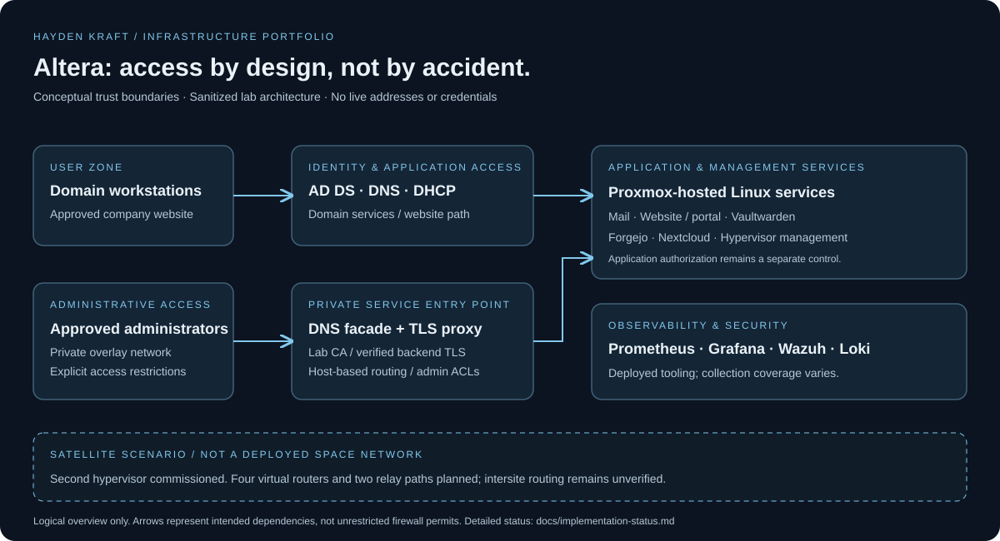

# Altera | Network Infrastructure & Security Lab

[](https://github.com/HaydenKraft23/altera-network-infrastructure/actions/workflows/validate.yml)

**A segmented enterprise lab built to practice the full lifecycle of infrastructure: design, deployment, secure access, monitoring, troubleshooting, and operational handoff.**

Project lead: **Hayden Kraft** · Academic team project · Sanitized engineering portfolio



## Project at a glance

Altera is a fictional communications company used as the business scenario for a real, hands-on infrastructure lab. The environment brings together Cisco networking, Proxmox virtualization, Windows identity services, Linux application hosting, private PKI, and observability.

The engineering challenge was not simply to start applications. It was to make them reachable by the right users, keep administrative services separate from user traffic, diagnose failures across multiple layers, and document what had actually been verified.

**The satellite company is fictional. The infrastructure work is real.** Satellite telemetry in this repository is explicitly synthetic; it is not RF, orbital, or production customer data.

| Focus | Work demonstrated |
|---|---|
| Network engineering | VLAN segmentation, 802.1Q trunks, management interfaces, switch-port and MAC-table verification |
| Virtualization | Two Proxmox hosts, Linux bridges, tagged management, VM provisioning and recovery planning |
| Identity | Active Directory, domain DNS, Windows domain joins, certificate-trust policy design |
| Secure access | ZeroTier remote administration, split DNS, NGINX reverse proxy, private CA and verified upstream TLS |
| Linux services | Internal mail, Forgejo, Nextcloud, Vaultwarden and a Flask-based internal website |
| Observability | Prometheus, Grafana, Wazuh and Loki, with verification gaps documented rather than hidden |
| Automation | Python and PowerShell, input validation, repeatable offline analysis, negative-path tests and CI |
| Operations | Runbooks, change records, restricted credential handling and tested recovery checkpoints |

## My contribution

I led the lab's infrastructure integration: selecting and connecting services, translating access requirements into network and proxy configuration, commissioning the satellite hypervisor, troubleshooting connectivity and trust issues, and maintaining operational documentation. This was a team project, not a claim that every component was built independently.

The examples here are curated, sanitized portfolio artifacts; service software and vendor platforms remain the work of their respective maintainers. See [scope and attribution](docs/scope-and-attribution.md).

## Engineering highlights

### 1. Private services with usable, trusted names

Combined private DNS, an NGINX gateway, and a lab certificate authority so approved administrators could use service names instead of remembering addresses and ports. TLS was also verified between the proxy and application backends; browser-side encryption was not treated as the entire trust boundary.

### 2. Evidence-driven network troubleshooting

Validated a newly installed Proxmox host from the physical NIC through the tagged management interface to the switch trunk. Used interface status, allowed/active/forwarding VLAN checks, MAC learning, ARP, ICMP, SSH and HTTPS as separate pieces of evidence.

### 3. Integrated administration and collaboration

Deployed private source control and shared document services with individual accounts, a shared administrative organization/group, restricted registration and separate persistent data. Application login was distinguished from OS access and from organization ownership.

### 4. Honest monitoring and recovery boundaries

Documented the difference between an installed agent and confirmed event ingestion, and between a VM snapshot and an independent backup. Outstanding verification work is visible in the [implementation status](docs/implementation-status.md).

Read the [technical case studies](docs/case-studies.md) for decisions, verification steps and lessons learned.

## What is in this repository?

```text
docs/                 Architecture, case studies, security and operations
examples/             Sanitized network, proxy and monitoring templates
fixtures/             Documentation-only inventory and synthetic telemetry
scripts/              Offline Python utilities and PowerShell diagnostics
tests/                Positive and negative-path automated tests
tools/                Publication safety checks
.github/workflows/    CI for tests, fixtures, examples and safety checks
```

This is **not** a full backup, a production deployment framework, or an export of the live lab. It deliberately excludes credential registers, password-manager imports, CA material, student photos, live configuration dumps and proprietary VM images.

## Run the offline examples

Requires Python 3.11 or newer. No third-party Python packages, lab access or network connectivity are required.

```bash
python -m unittest discover -s tests -v
python scripts/validate_inventory.py fixtures/inventory.json
python scripts/analyze_telemetry.py fixtures/telemetry.json
python tools/check_publication.py
```

The telemetry fixture contains **192 synthetic samples** across two modeled relays. Analysis identifies eight injected degraded samples on the first relay and none on the second. This demonstrates data handling and validation—not satellite failover or production performance.

For an authorized, read-only TCP check from Windows:

```powershell
.\scripts\Test-ServiceEndpoint.ps1 -ComputerName localhost -Port 443
```

Supply a host you own or are authorized to test. The script tests TCP reachability only; it does not establish TLS trust or application health.

## Implementation status

Baseline: retained project records and verification from **October 26–28, 2026**. Portfolio prepared October 30, 2026. This repository does not perform a fresh live audit.

| Area | Recorded state |
|---|---|
| Core applications and private proxy | Deployed; selected login, delivery and HTTPS checks recorded |
| Satellite hypervisor | Installed; management trunk, SSH and trusted proxy endpoint verified |
| Satellite router VMs / intersite transport | Planned; no satellite guest VMs at the last host check |
| Windows trust GPO | Deployment instructions prepared; client application not confirmed |
| Wazuh / Loki ingestion coverage | Services present; full end-to-end coverage not established |
| Recovery | Baseline snapshots and a verified encrypted manual backup copy; broader automated off-host coverage pending |
| DMZ and user-traffic analytics | Proposed, not deployed |

## Documentation

- [Architecture and trust boundaries](docs/architecture.md)
- [Technical case studies](docs/case-studies.md)
- [Implementation and evidence status](docs/implementation-status.md)
- [Security decisions and limitations](docs/security.md)
- [Operational runbook](docs/operations.md)
- [Scope, attribution and portfolio notes](docs/scope-and-attribution.md)
- [Safe use of configuration examples](examples/README.md)

## Safe publication

Only documentation addresses and example hostnames are used in the published artifacts. Configuration samples are reconstructed examples, not live device backups. The publication checker is a useful guardrail, **not** a substitute for manual review or a dedicated secret scanner.

No public live demo is provided: the administrative lab remains private. See [SECURITY.md](SECURITY.md) before reporting a concern.
