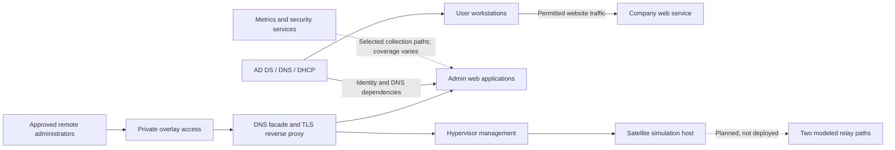

# Architecture and trust boundaries

## Logical layout



This is a logical dependency diagram, not a literal cable map. Arrow direction does not imply an unrestricted firewall permit. The physical paths include a router, switch, firewall and VLAN trunks; the compact illustration omits device-level detail.

## Segmentation

| Zone | Role | Access intent |
|---|---|---|
| User | Windows lab clients | Domain dependencies and approved company website |
| Services | Linux applications | Only explicit application and administrative paths |
| Identity | Physical Windows domain controller | Required domain protocols, tightly scoped management |
| Monitoring | Metrics and security tooling | Explicit collection and administration paths |
| Management | Hypervisors and infrastructure | Approved administrators, not general users |
| IoT | Camera onboarding and isolation | Intended dedicated device segment; onboarding exception requires review |
| Satellite transport | Virtual router underlay | Isolated path experiments; intersite design not yet validated |

## Service roles

- **Proxmox:** the main application host and a second, newly commissioned satellite host.
- **Windows Server:** Active Directory, DNS and DHCP. Domain membership does not by itself grant application administration.
- **VPN/DNS/proxy gateway:** provides approved remote access, private service-name resolution and TLS termination with verified backend connections.
- **Security and monitoring:** Wazuh for security events; Prometheus/Grafana for metrics; Loki for logs. An installed service is not proof of collection coverage.
- **Applications:** internal mail, a company website/admin portal, Vaultwarden, Forgejo and Nextcloud.

## Request and certificate paths

```text
Approved admin -> private DNS -> reverse proxy:443 -> verified backend TLS
Domain client  -> domain DNS  -> approved website endpoint
```

The proxy certificate chains to a lab-controlled private CA. Clients need the public trust anchor. The proxy separately verifies its upstream certificate and hostname. Backend CA replacement therefore needs a deliberate trust update.

Domain-wide certificate distribution was requested, but successful application to the test workstation had not been confirmed in the retained evidence. The public examples do not distribute a real CA certificate.

## Availability limits

Multiple VMs on one physical host are not independent failure domains. The main host still concentrates identity dependencies, application availability and remote-access dependencies. A second hypervisor dedicated to the relay scenario does not automatically make the applications highly available.

The two proposed satellite paths model logical routing diversity. They must not be described as independently redundant physical satellite links.
